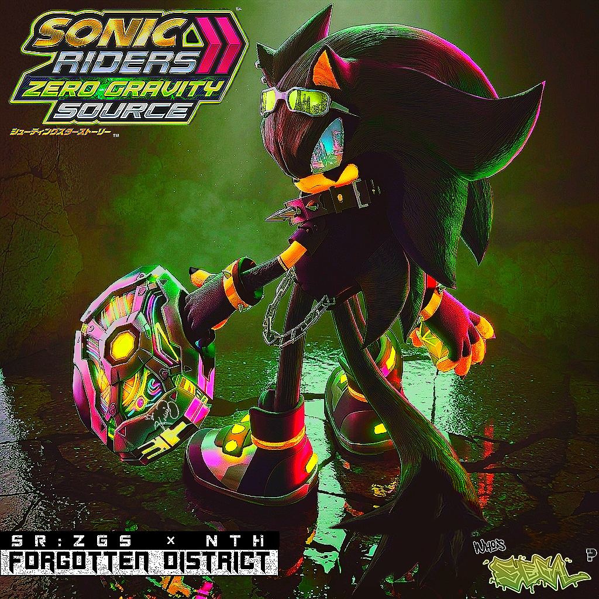

<p align="center">
  
</p>

<h1 align="center">
  Sonic Riders: Zero Gravity — Static Recompilation
</h1>

<p align="center">
  <a href="LICENSE">
    
  </a>
  <a href="#">
    
  </a>
  <a href="#">
    
  </a>
  <a href="#">
    
  </a>
  <a href="#">
    
  </a>
  <a href="#">
    
  </a>
  <a href="#">
    
  </a>
  <a href="https://github.com/KnivesDevilish/SR-ZGS/stargazers">
  
  </a>
</p>

A modern static recompilation project for **Sonic Riders: Zero Gravity** (Nintendo Wii), with the long-term goal of delivering a high-performance native PC experience on Linux and Windows, with Android support as a future target.

The project uses **DolRecomp** to generate native code from the original PowerPC game executable and **ModernGekko**, a Dolphin-derived runtime, to provide the execution environment and Wii hardware services.

SR-ZGS aims to provide a clean, modular architecture that separates recompiled game logic, modding facilities, and hardware-agnostic platform interfaces, progressively reducing its reliance on existing emulation technology.

**Current Status:** SR-ZGS is an experimental hybrid static recompilation project. It still relies on ModernGekko for graphics, audio, input and system-level functionality. A fully independent native runtime is a long-term development goal.

Requires your own legally obtained copy of the game.

---

## Project Status

**Current stage: Experimental — Phase 1**

- [x] DolRecomp code generation for the Wii executable.
- [x] Integration of the generated game module with ModernGekko.
- [x] PC execution through the ModernGekko runtime.
- [x] Full game completion successfully tested using ModernGekko's JIT64 CPU core.
- [x] 60 FPS observed during developer testing using JIT64.
- [x] StaticRecomp execution path tested.
- [ ] Improve and optimize StaticRecomp execution performance.
- [ ] Independent runtime implementation.
- [ ] Independent graphics and audio systems.
- [ ] Broader hardware and operating system testing.
- [ ] Native modding support.

### Performance Notes

The 60 FPS result was achieved using ModernGekko's JIT64 CPU core with `MODERNGEKKO_STATICRECOMP=0`.

The StaticRecomp CPU core (`MODERNGEKKO_STATICRECOMP=1`) has also been tested, but currently exhibits significantly lower performance on the reference hardware.

Improving the performance of the StaticRecomp execution path is an ongoing development goal.

These results are specific to the tested hardware and configuration and should not be considered universal performance guarantees.

---

<p align="left">
  
</p>

## 🐧 Architecture

SR-ZGS currently consists of three main components:

### DolRecomp

Translates the original PowerPC game executable (`main.dol`) into generated C code that can be compiled for desktop systems.

### ModernGekko

Provides the runtime environment that hosts the generated game module.

ModernGekko is based on Dolphin technology and currently provides:

- Graphics and rendering.
- Audio services.
- Controller and input handling.
- Wii system-level functionality.

### SR-ZGS integration

The project's own code connects the generated module to ModernGekko.

Current source components:

- `src/recompiled/`: Generated code produced by DolRecomp.
- `src/core/`: Project-specific hooks and replacements.
- `src/platform/`: Module staging, runtime configuration and launch integration.
- `tools/`: Build scripts and recompilation configuration.
- `external/ModernGekko/`: ModernGekko submodule.
- `game_assets/`: Extracted game files (not distributed).

The project does not yet provide its own independent renderer, audio backend or Wii system implementation.


---

## ⚙️ Prerequisites & Setup

### Requirements

- **Compiler:** C11-compatible C compiler and C++23-compatible C++ compiler (required by ModernGekko). The main SR-ZGS module uses C++20.
- **Build System:** CMake 3.22+ and Ninja.
- **Additional Tools:** Git and pkg-config.
- **Recompilation Tools**: [DolRecomp](https://github.com/ExpansionPak/DolRecomp), [ModernGekko](https://github.com/ExpansionPak/ModernGekko).
  - Both components are integrated into the project's build workflow.
- **Game Assets**: A legally obtained NTSC-U copy of *Sonic Riders: Zero Gravity* (Wii, Game ID: `RS9E8P`), with its extracted game files.

---

## 📝 Key Goals & Features

The long-term objective is to make SR-ZGS progressively more independent from its current runtime.

Potential development areas include:

- Investigating and progressively replacing runtime-dependent Wii services.
- Developing independent graphics and audio implementations.
- Improving compatibility across different PC hardware.
- Expanding configuration and customization options.
- Exploring native modding capabilities.

These are development goals, not features currently promised or available.

---

## 📁 Repository Structure

The repository is organized as follows:

```text
SR-ZGS/
├── database/
├── docs/
├── external/
│   └── ModernGekko/           # Dolphin-derived runtime submodule
├── game_assets/               # User-provided game files (not distributed)
├── mods/                      # Reserved for future project mod support
├── src/
│   ├── recompiled/            # DolRecomp-generated game code
│   ├── core/                  # Optional project-specific hooks and replacements (disabled by default).
│   └── platform/              # Runtime staging and launch integration
├── tools/
│   ├── dolrecomp/
│   └── build_tools.sh
├── CMakeLists.txt
├── CMakePresets.json
└── LICENSE
```

---

## 💻 Platform Status

SR-ZGS is currently in an experimental development stage.

- **Linux:** Current development and testing platform. Tested on Bazzite Linux with Wayland.
- **Windows:** Intended desktop target. Compatibility testing is still needed.
- **Android:** Long-term development target. No working Android build is currently provided.

For detailed hardware specifications, graphics settings, CPU execution modes and performance results, see [TESTING.md](docs/TESTING.md).

This is an observed test result, not a universal performance guarantee. Actual performance may vary depending on hardware, runtime configuration and future changes.

---

## 🚧 Game Asset Setup

SR-ZGS does not distribute copyrighted game executables or assets. You must provide your own legally obtained copy of **Sonic Riders: Zero Gravity** for Nintendo Wii.

### Required Game Copy

- NTSC-U release.
- Game ID: `RS9E8P`.
- A clean, unmodified disc dump is recommended.

### Extracting Game Files

1. Extract the contents of your Wii disc image using a suitable tool, such as Dolphin Emulator, Wiimm's ISO Tools or CleanRip.
2. Place the extracted game directory inside `game_assets/`.
3. Preserve the original directory structure.

The expected directory layout is:

```text
game_assets/
├── sys/
│   ├── main.dol
│   └── boot.bin
└── files/
```

The build configuration expects the extracted game root to contain both `sys/` and `files/`.

> [!NOTE]
> This repository does not provide or distribute any copyrighted game binaries or assets. You must extract the required game files from your own legally obtained copy, including `main.dol` and the required game data directories, to build and run SR-ZGS.

---
## 🚀 Building & Getting Started

### 1. Clone the Repository

Clone SR-ZGS with all its required submodules:

```bash
git clone --recursive https://github.com/KnivesDevilish/SR-ZGS.git
cd SR-ZGS
```

### 2. Build DolRecomp and ModernGekko

Build DolRecomp and the ModernGekko runtime:

```bash
bash tools/build_tools.sh --chassis
```

This builds the recompilation tool and the ModernGekko runtime required to execute the game.

### 3. Generate the Recompiled Game Code

Run the recompilation script:

```bash
bash tools/dolrecomp/recompile.sh
```

The generated code will be placed inside `src/recompiled/`.

### 4. Configure and Build SR-ZGS

Configure the Release preset:

```bash
cmake --preset release
```

Compile the project:

```bash
cmake --build --preset release
```

### 5. Launch SR-ZGS

SR-ZGS supports two CPU execution modes through ModernGekko.

#### Recommended: JIT64 Mode

For the current reference configuration, use JIT64 mode:

```bash
MODERNGEKKO_STATICRECOMP=0 cmake --build --preset quick --target srzgs_run
```

This selects ModernGekko's JIT64 CPU core and corresponds to the configuration in which 60 FPS was observed during developer testing.

#### Experimental: StaticRecomp Mode

To test the StaticRecomp CPU execution path:

```bash
MODERNGEKKO_STATICRECOMP=1 cmake --build --preset quick --target srzgs_run
```

StaticRecomp is currently under performance investigation and may run significantly slower on some hardware.

If `MODERNGEKKO_STATICRECOMP` is not specified, ModernGekko selects StaticRecomp by default.

### Build Configuration

The project provides two CMake presets:

- **Quick:** Uses `-O1` for generated game code and is intended for development iterations.
- **Release:** Uses `-O2` for generated game code and is intended for optimized builds.

Both presets use the same runtime integration and support the JIT64 and StaticRecomp execution modes.

Build scripts and dependencies may change as the project evolves.

---

## 🧩 Future Ecosystem & Expansion Plans

### 💽 Custom Story Expansions & Modding Support

One of the long-term ambitions of **Sonic Riders: Zero Gravity Source** is to establish a modular ecosystem for custom content and community-created expansions.

The project aims to eventually support original story campaigns, additional characters, custom tracks, cutscenes and other fan-created content without requiring modifications to the original game assets.

Potential projects and concepts include:

- Custom story campaigns.
- Additional character slots.
- Original tracks and environments.
- Community-created expansions.
- Extended gameplay features.

One of the concepts envisioned for this ecosystem is:

***SR-ZGS × NTH — FORGOTTEN DISTRICT***

<p align="left">
  
</p>

<sub>This is a planned expansion concept and part of the project's long-term vision. Its implementation depends on future development of the required modding and expansion systems.</sub>

---

## 🤝 Contributing & FAQ

SR-ZGS is an experimental project, and contributions, technical feedback and testing reports are welcome.

Areas where help would be valuable include:

- C and C++ development.
- PowerPC and Wii system research.
- Static recompilation.
- Runtime development.
- Hardware compatibility testing.
- Documentation.

Whether you're interested in contributing code, testing the project or sharing technical knowledge, your help is appreciated.

Constructive feedback is always welcome. <3

### Does SR-ZGS currently support mods?
Not yet. Native project-specific mod loading is a future development goal. The `mods/` directory is reserved for future use and does not currently represent a fully implemented SR-ZGS mod loader.

### Does SR-ZGS require Dolphin?
SR-ZGS currently uses **ModernGekko**, a Dolphin-derived runtime, to provide graphics, audio, input and Wii system services. A more independent runtime is a long-term development goal.

### Does the project run at 60 FPS?
The game successfully ran from start to finish at 60 FPS during developer testing. This is an observed result from a specific test configuration, not a guarantee for every system.

### Can I use files from the PS2 or GameCube versions?
No. SR-ZGS specifically targets the NTSC-U Nintendo Wii release of Sonic Riders: Zero Gravity (`RS9E8P`). Other versions have different executable structures and are outside the current project scope.

### Will Android be supported?
Android is a long-term target for the project. However, there is currently no supported Android build or verified mobile compatibility.

### Will custom story campaigns and fan content be supported?
Custom story campaigns, additional characters, tracks and other fan-created content are possibilities for future development. These features are not currently implemented.

### Are additional languages or voice localizations planned?
Additional text and audio localization options may be explored in the future. No additional fan-dub integration is currently included in the working build.

### Do you plan to recompile other Sonic games?
SR-ZGS is currently focused on Sonic Riders: Zero Gravity. The project does not currently have plans to expand its scope to other Sonic titles.

---

## ❤️‍🔥 Credits & Acknowledgments

- **DolRecomp** — Static recompilation framework.
- **ModernGekko** — Runtime environment used by SR-ZGS.
- **Dolphin Emulator contributors** — Foundation for much of the runtime technology.
- **SR-ZGS contributors and testers** — Research, development and testing.

This project is an independent fan project and is not affiliated with or endorsed by SEGA.
