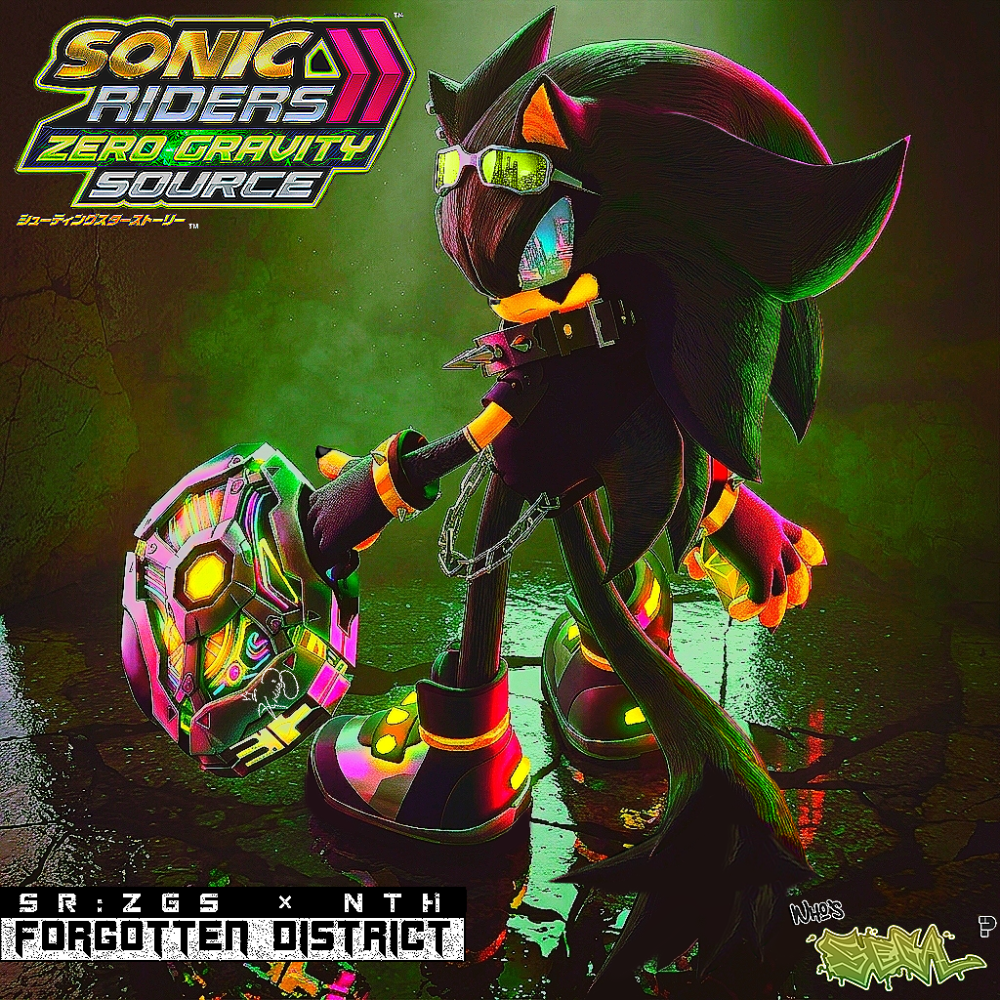

# Sonic Riders: Zero Gravity — Static Recompilation

[](LICENSE)
[](#)
[](#)

A modern, high-performance static recompilation project for **Sonic Riders: Zero Gravity** (Nintendo Wii) for native PC (Linux and Windows) & Android. Designed with a clean, modular architecture isolating recompiled game logic, modding facilities, and hardware-agnostic platform hooks. Requires your own copy of the game.

---

## 🐧 Architecture

The repository enforces strict separation of concerns to guarantee performance and maintainability across all system layers:

* **`docs/`**: Architecture documentation & reversing notes.
* **`tools/`**: Build tools & DolRecomp configs (`tools/dolrecomp/` toolchain configuration).
* **`game_assets/`**: Extracted ISO/ROM assets (not tracked by Git).
* **`src/recompiled/`**: Output C/C++ code generated by DolRecomp.
* **`src/core/`**: Core engine runtime (memory, hooks, lifecycle management).
* **`src/graphics/`**: Renderer backend (GX to Modern Graphics API translation).
* **`src/audio/`**: Audio system (DSP / AX translation).
* **`src/input/`**: Controller and input mapping logic.
* **`src/mod_loader/`**: Native mod loading subsystem & file overrides.
* **`src/platform/`**: Platform abstraction layers (rendering backends, audio drivers, OS interfaces).
* **`src/extensions/`**: Custom logic (New character slots, custom story engine).
* **`src/expansions/`**: Custom feature additions, extended engine limits, and experimental re-implementations.
* **`external/`**: Third-party dependencies and submodule integrations.
* **`mods/`**: Default workspace directory for user/custom mods.
* **`CMakeLists.txt`**: Primary build configuration.

---

## ⚙️ Prerequisites & Setup

### Requirements
* **Compiler**: GCC 12+, Clang 15+, or Android NDK r25+ (C++20 support required)
* **Build System**: CMake 3.22+
* **Recompilation Tool**: [DolRecomp](https://github.com/ExpansionPak/DolRecomp)
* **Game Assets**: Legally acquired `main.dol` extracted from *Sonic Riders: Zero Gravity* (RS9E01 / RS9P01).

---

## 📝 Key Goals & Features

- **Native Performance & Scalability:** 
  - Direct execution without traditional emulation overhead.
  - Native **60 FPS** target.
  - Resolution scalability (optimized to run on integrated GPUs such as Intel HD 5500 while scaling up to 4K on high-end hardware).
- **Embedded Native Mod Loader:** 
  - Dynamic loading of assets (models, textures, audio, scripts) directly from a `mods/` directory.
  - No external third-party mod manager required.
- **Extensible Content Architecture:**
  - Expanded Character Slots: Dynamic table architecture replacing fixed-size arrays.
  - Custom Story Mode: Support for new storyline campaigns, cutscenes, and stage sequences.
- **Clean & Maintainable Codebase:**
  - Strict separation of decompiled/recompiled code, runtime abstraction layer, and custom extensions.

---

## 📁 Repository Structure

```text
SR-ZGS/
├── docs/                      # Architecture documentation & reversing notes
├── tools/                     # Build tools & DolRecomp configs
│   └── dolrecomp/             # Toolchain configuration for SR:ZG
├── game_assets/               # Extracted ISO/ROM assets (not tracked by Git)
├── src/
│   ├── recompiled/            # Output code generated by DolRecomp
│   ├── core/                  # Core engine runtime (memory, hooks, lifecycle)
│   ├── graphics/              # Renderer backend (GX to Modern Graphics API translation)
│   ├── audio/                 # Audio system (DSP / AX translation)
│   ├── input/                 # Controller and input mapping logic
│   ├── mod_loader/            # Native mod loading subsystem & file overrides
│   ├── platform/              # Platform abstraction layers (rendering backends & OS drivers)
│   ├── extensions/            # Custom logic (New character slots, story engine)
│   └── expansions/            # Custom feature additions, extended engine limits
├── external/                  # Third-party dependencies and submodule integrations
├── mods/                      # Default directory for user/custom mods
└── CMakeLists.txt             # Primary build configuration
```

---


## 🛠️ Code Standards & Architecture Guidelines

When developing features or requesting AI assistance (e.g., via Claude AI), adhere to these principles:

1. **Strict Modularization:** Keep raw recompilation code (`src/recompiled/`) isolated from core runtime logic (`src/core/`), platform rendering/input drivers (`src/platform/`), and custom features (`src/extensions/` & `src/expansions/`).
2. **Hardware Abstraction Layer (HAL):** Implement platform-specific graphics (GX translation to Vulkan/OpenGL) and input/audio backend logic exclusively inside `src/platform/` to ensure zero-cost portability between Linux, Windows, and Android.
3. **Dynamic Memory Allocation over Hardcoded Tables:** Avoid fixed array limits inherited from GameCube/Wii memory constraints. Wrap character and stage tables into expandable vectors or dynamic registries.
4. **Non-Invasive Patching:** Override game behavior via hook points and event handlers rather than modifying raw decompiled function outputs directly whenever possible.
5. **Performance First:** Keep hot path loops clean and minimal to ensure smooth framerates on low-power devices.

---

## 💻 Target System Compatibility

- **Minimum Specification Target (PC):** Intel Core i5-5200U, Intel HD Graphics 5500, 16 GB RAM (720p/1080p @ 60 FPS target).
- **Mobile Target (Android):** Mid-range ARM64 devices (e.g., Qualcomm Snapdragon 6s Gen 3 / Adreno 619, 8 GB RAM like Xiaomi POCO M8s 5G) targeting stable **60 FPS @ 1080p** via Vulkan API.
- **High-End Target:** 4K Native Rendering @ 60 FPS on dedicated GPUs.

---

## 🚧 How to Install

1) You must have access to the following:
    - A clean, legally acquired copy of **Sonic Riders: Zero Gravity** for Nintendo Wii (NTSC-U / Game ID: `RS9E8P` / `0001000052533945`).
    - Standard tools to extract game files from a Wii disc image (e.g., Dolphin Emulator, Wiimms ISO Tools, or CleanRip on an original Wii console).

> [!TIP]
> Make sure your ISO or WBFS dump is clean and unmodified. Modified game dumps or scrubbed files with missing data may cause errors during the recompilation and setup steps.

2) **Extract Game Executable:**
    - Extract `main.dol` from the root partition of your game dump.
    - Place the extracted `main.dol` file inside the `game_assets/` folder of this project.

3) **Run Static Recompilation (DolRecomp):**
    - Execute DolRecomp using the project configurations located in `tools/dolrecomp/`.
    - Verify that the generated recompiled C/C++ source files are placed in `src/recompiled/`.

4) **Build & Run:**
    - Configure and compile the repository using CMake (refer to the [Building & Getting Started](#-getting-started) section below).
    - Launch the compiled executable.

> [!NOTE]
> This repository **does not provide or distribute any copyrighted game binaries or assets**. You must extract `main.dol` from your own legally obtained game copy to compile and run SR-ZGS.

---

## 🚀 Getting Started

1. **Clone Repository & Submodules:**
   ```bash
   git clone --recursive https://github.com/KnivesDevilish/SR-ZGS.git
   cd SR-ZGS
   ```

2. **Obtain Game ROM & Extract DOL:**
   - Obtain a clean NTSC-U/PAL ISO/WBFS of *Sonic Riders: Zero Gravity* for Nintendo Wii.
   - Extract `main.dol` using standard Wii tools (e.g., Wiimms ISO Tools / Dolphin) into `game_assets/`.

3. **Run Static Recompiler (DolRecomp):**
   - Execute DolRecomp using the project configuration in `tools/dolrecomp/` to output C/C++ recompiled code into `src/recompiled/`.

4. **Build Project (PC / Desktop):**
   ```bash
   cmake -B build -DCMAKE_BUILD_TYPE=Release
   cmake --build build --config Release
   ```

5. **Build Project (Android):**
   - Open the Android CMake target using Android Studio or build via `./gradlew assembleRelease` with the NDK toolchain configured.

---



### 💽 Custom Story Expansions & Modding Support
The modular nature of `Sonic Riders: Zero Gravity Source` isolates custom expansions (`src/expansions/`) from the base game code. This allows the integration of rich, original story campaigns, unique characters, and custom tracks (such as the upcoming *Forgotten District* expansion) without modifying raw original game assets.

---

## ❔ Troubleshooting & FAQ

### How can I install mods?
**Do not install mods by modifying the raw game assets directly**. Use the built-in mod loader subsystem (`src/mod_loader/`) or compatible mod directories instead[cite: 2]. You will not get support for modifying your extracted files directly[cite: 2].

> [!WARNING]
> Manually editing or replacing core game files within `game_assets/` is not recommended, as it can cause structural conflicts with the recompiled engine.

### How can I force the game to run under X11 or Wayland (Linux)?
Use either of the following arguments to force SDL to run under your preferred video driver[cite: 2]:
- X11: `--sdl-video-driver x11`[cite: 2]
- Wayland: `--sdl-video-driver wayland`[cite: 2]

### How can I improve performance?
If you experience performance drops, you can adjust the following settings in your configuration file or options menu:
- Resolution Scale
- Anti-Aliasing Quality
- Shadow Resolution

> [!NOTE]
> Since this project targets native multi-platform compilation, running on Linux distributions can sometimes offer better thread scheduling performance compared to Windows on modest hardware.

### Why is my controller not being recognized properly?
If you are using third-party input translation layers (such as Steam Input or external wrappers), try toggling them off if you experience button mapping conflicts, as the engine utilizes native SDL input handling.

### Will Android be supported?
While Phase 1 focuses strictly on native PC builds (Linux/Windows), modular architecture is kept clean via the platform layer (`src/platform/`) to evaluate mobile/Android builds in future phases.

### Can I use files from the PS2 or GameCube versions?
**No.** This project strictly targets the Nintendo Wii NTSC-U release (`RS9E8P` / `0001000052533945`). The PS2 version uses a completely different executable structure and rendering pipeline, while the original *Sonic Riders* (GameCube/PS2/PC) is a different game entirely.

### Will the project support custom story campaigns or fan content?
**Yes.** Thanks to the non-invasive `src/expansions/` architecture, developers and creators can build custom story expansions, original character additions, and new tracks. Official modular expansions, such as *SR:ZGS × NTH - FORGOTTEN DISTRICT*, will be integrated cleanly on top of the base recompiled engine.

### What languages and audio localizations will be supported?
Out of the box, the game will natively support:
- **English:** Full original voice track featuring the iconic Sonic Riders: Zero Gravity cast.
- **Japanese:** Full original Japanese voice track and text localization.
- **Latin American Spanish (New feature):** For the first time ever, *Sonic Riders: Zero Gravity* will feature a fan-dubbed Latin American Spanish voice track produced in collaboration with community voice actors working closely with the project team.

### Do you have plans to recompile other Sonic games?
**No.** The primary focus of this repository is strictly the preservation, modernization, and modular expansion of *Sonic Riders: Zero Gravity*. Anyone interested in recompiling other Wii or GameCube titles is encouraged to explore [DolRecomp](https://github.com/ExpansionPak/DolRecomp) and build their own project repositories.

---

## ❤️‍🔥 Credits & Acknowledgments

### Project Leads & Core Development
- **奈依茲・悪魔的 | (Naizu Akumateki):** Creator, Lead Developer, and Architect of the static recompilation and modular integration for *Sonic Riders: Zero Gravity Source*.

### Audio & Localizations
- **Latin American Spanish Voice Cast:** ***SHOOTING STAR CAST*** Community voice actors and artists contributing their talents for the brand-new Latin American Spanish dub integration.
- **Original Audio Tracks:** Based on the official English and Japanese audio assets from the original Nintendo Wii release.

### Tools & Technologies
- **[DolRecomp](https://github.com/dolrecomp):** The core static recompilation framework utilized for translating the original PowerPC `main.dol` executable of *Sonic Riders: Zero Gravity* into modern C/C++.

### Special Thanks
- To all open-source contributors, community testers, and fans supporting the preservation and modernization of classic arcade racing titles, as well as helping bring my passion project, Sonic Riders: Zero Gravity Source, to life.

---

## 📜 AI Context Prompt Template

When feeding tasks to Claude AI or other assistants, prefix requests with:

> *"Project Context: Sonic Riders: Zero Gravity Source (SR:ZGS). Maintain high modularity, prevent spaghetti code, and strictly follow the architecture defined in README.md."*
